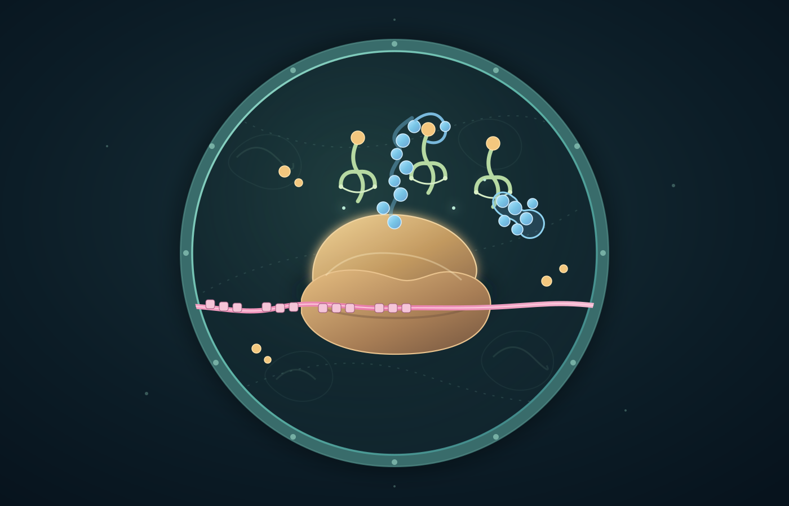
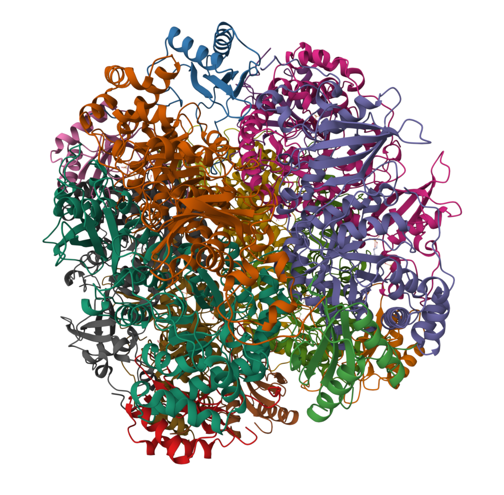
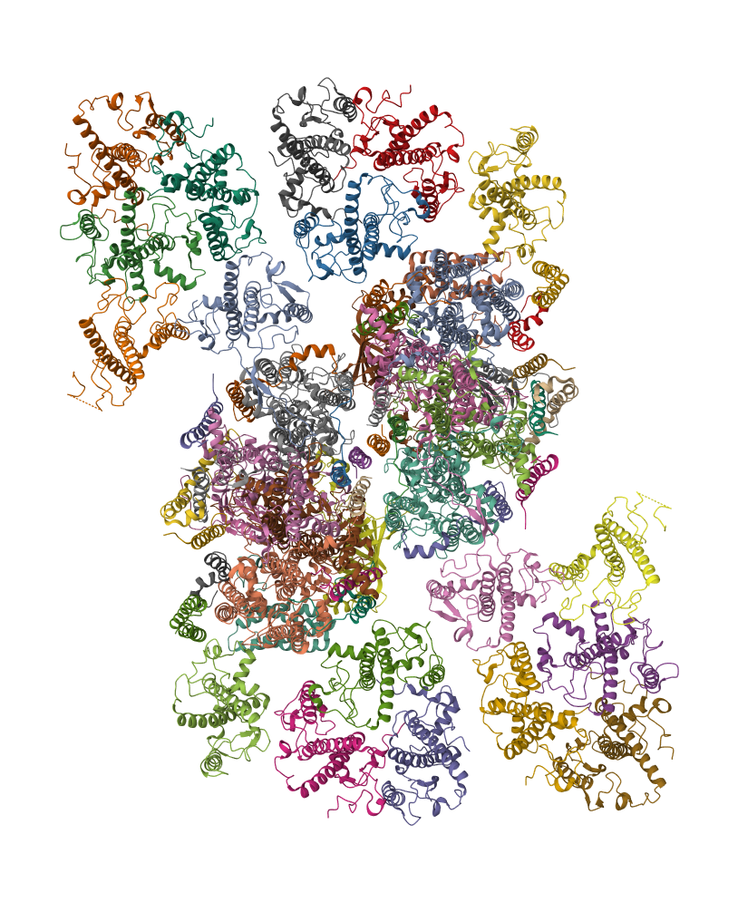
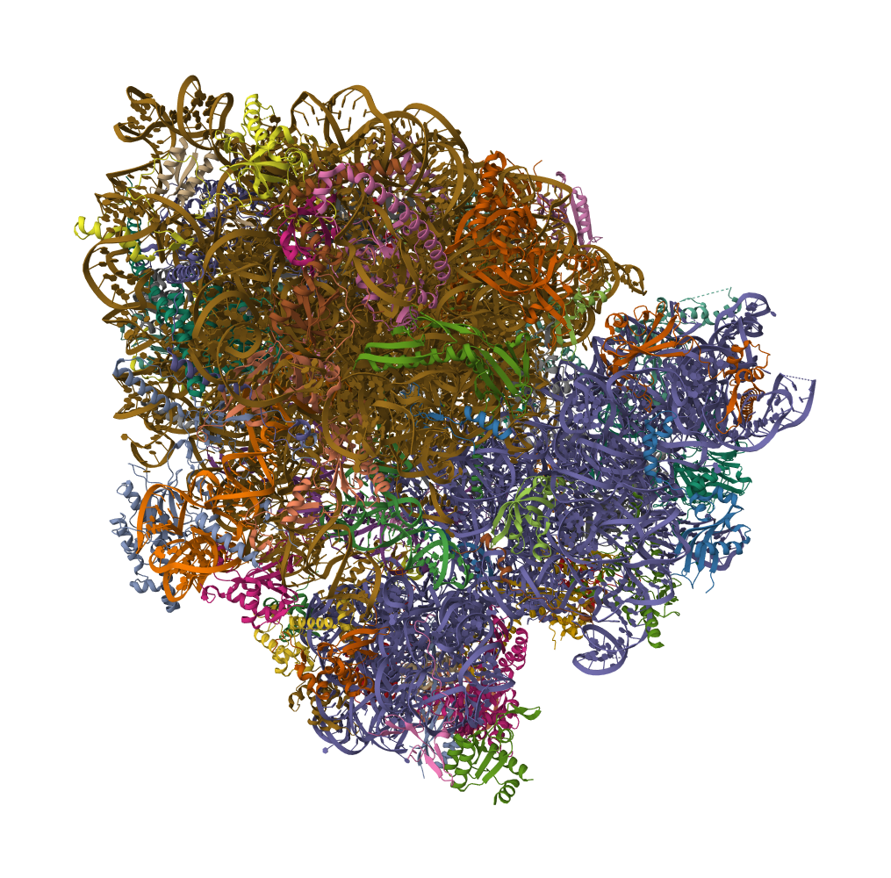

  <h1 align="center">Boluwatife K. Ikuerowo</h1>

  

  
  
  

---

<picture>
  <source media="(prefers-color-scheme: dark)" srcset="assets/plant-cell-organelle-tour.svg">
  <source media="(max-width: 600px)" srcset="assets/plant-cell-organelle-tour.svg">
  
</picture>

A guided exploration of a plant cell, from its protective cell wall and plasma membrane to the organelles responsible for energy production, protein synthesis, intracellular transport, and cellular regulation. The illustration highlights the structure and functions of the nucleus, chloroplasts, mitochondria, endoplasmic reticulum, Golgi apparatus, ribosomes, and central vacuole.

 

<picture>
  <source media="(prefers-color-scheme: dark)" srcset="assets/protein-synthesis-cell-animation.svg">
  <source media="(max-width: 600px)" srcset="assets/protein-synthesis-cell-animation.svg">
  
</picture>

Protein synthesis translates genetic information carried by messenger RNA into a polypeptide chain. During translation, the ribosome reads mRNA codons, transfer RNAs deliver their corresponding amino acids, and peptide bonds connect the amino acids into a growing chain that eventually folds into a functional protein.

 

  
  &nbsp;&nbsp;
  
  &nbsp;&nbsp;
  

  
    Spinach Rubisco,
    <a href="https://www.rcsb.org/structure/1RCX">PDB 1RCX</a>
    &nbsp;·&nbsp;
    Plant photosystem II,
    <a href="https://www.rcsb.org/structure/5XNL">PDB 5XNL</a>
    &nbsp;·&nbsp;
    Plant 80S ribosome,
    <a href="https://www.rcsb.org/structure/8B2L">PDB 8B2L</a>
  

 

  
    <a href="https://github.com/codegenius13">GitHub</a>
    &nbsp;·&nbsp;
    <a href="https://orcid.org/0009-0006-8209-1912">ORCID</a>
    &nbsp;·&nbsp;
    <a href="https://scholar.google.com/citations?user=CVHsvioAAAAJ&hl=en">Google Scholar</a>
    &nbsp;·&nbsp;
    <a href="https://www.linkedin.com/in/boluwatife-ikuerowo-80490226b/">LinkedIn</a>
  

