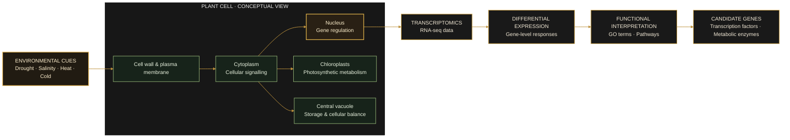

<!--
  PROFILE README — codegenius13
  Palette: charcoal / ivory / antique gold
  Built with GitHub-flavoured Markdown, HTML tables and Mermaid.
  GitHub does not execute custom CSS or JavaScript in README files.
-->

<strong>CODEGENIUS13</strong> &nbsp; ━━━━━━━━━━━━━━━━━━━━━━━━━━━━━━━━━ &nbsp; <em>RESEARCH · INNOVATE · ADVANCE</em>

# IKUEROWO BOLUWATIFE KOLADE

### Biotechnologist &nbsp; | &nbsp; Molecular Biology &nbsp; | &nbsp; Plant Bioinformatics

**Biochemistry** &nbsp; · &nbsp; **Phytochemistry** &nbsp; · &nbsp; **Plant Biotechnology** &nbsp; · &nbsp; **Computational Biology**

  <a href="https://bolu.onrender.com">Portfolio</a>
  &nbsp; ◆ &nbsp;
  <a href="https://github.com/codegenius13">GitHub</a>
  &nbsp; ◆ &nbsp;
  <a href="https://github.com/codegenius13?tab=repositories">Repositories</a>

<em>Exploring plant systems from biochemical foundations to molecular responses — connecting biological questions with computational analysis.</em>

---

## 01 &nbsp; / &nbsp; RESEARCH PROFILE

<table>
  <tr>
    <td width="62%" valign="top">
      <h3>About me</h3>
      
I am a Biochemistry graduate of <strong>Olusegun Agagu University of Science and Technology (OAUSTECH)</strong>, with a strong interest in plant biotechnology, molecular biology, plant bioinformatics and phytochemistry.

      
My interests sit at the intersection of biochemical processes and molecular data: understanding how genes, regulatory factors and metabolic pathways contribute to plant function and responses to environmental conditions.

      
I enjoy using computational approaches to investigate biological datasets, interpret gene-expression patterns and communicate research findings clearly.

    </td>
    <td width="38%" valign="top">
      <h3>Research direction</h3>
      
<strong>Plant systems</strong> Plant molecular biology · Plant biotechnology

      
<strong>Biological chemistry</strong> Biochemistry · Phytochemistry · Metabolism

      
<strong>Computational methods</strong> Bioinformatics · Transcriptomics · Data analysis

      
<strong>Applications</strong> Crop stress responses · Agricultural biotechnology

    </td>
  </tr>
</table>

---

## 02 &nbsp; / &nbsp; INSIDE THE PLANT CELL

*A simplified conceptual map — from environmental cues and cellular organisation to the molecular data used in plant research.*

This is an educational overview, not a claim that every stress response follows one linear pathway. Biological responses vary by species, tissue, developmental stage and experimental conditions.

---

## 03 &nbsp; / &nbsp; AREAS OF INTEREST

<table>
  <tr>
    <td width="50%" valign="top">
      <h3>Plant biotechnology & molecular biology</h3>
      <ul>
        <li>Plant cell and molecular biology</li>
        <li>Plant responses to abiotic stress</li>
        <li>Gene expression and transcriptional regulation</li>
        <li>Plant metabolic processes</li>
      </ul>
    </td>
    <td width="50%" valign="top">
      <h3>Bioinformatics & computational biology</h3>
      <ul>
        <li>Plant transcriptomics and RNA-seq analysis</li>
        <li>Differential gene-expression analysis</li>
        <li>Functional annotation and enrichment</li>
        <li>Candidate gene and regulatory analysis</li>
      </ul>
    </td>
  </tr>
  <tr>
    <td width="50%" valign="top">
      <h3>Biochemistry & phytochemistry</h3>
      <ul>
        <li>Metabolic pathways and enzyme function</li>
        <li>Plant secondary metabolites</li>
        <li>Phytochemical and natural-product research</li>
        <li>Biochemical interpretation of plant traits</li>
      </ul>
    </td>
    <td width="50%" valign="top">
      <h3>Data, AI & agricultural systems</h3>
      <ul>
        <li>Research data analysis and visualisation</li>
        <li>AI-enabled agricultural applications</li>
        <li>Smart farming and supply-chain systems</li>
        <li>Data-informed approaches to sustainability</li>
      </ul>
    </td>
  </tr>
</table>

---

## 04 &nbsp; / &nbsp; BIOINFORMATICS TOOLKIT

| Workflow | Tools and technologies |
|:--|:--|
| **Programming & analysis** | `Python` · `R` · `Bash` |
| **Sequence analysis** | `BLAST` · `MEGA` |
| **RNA-seq quality control** | `SRA Toolkit` · `FastQC` · `MultiQC` · `fastp` |
| **Read alignment** | `HISAT2` |
| **Differential expression** | `DESeq2` |
| **Computing environment** | `Ubuntu` · `WSL2` · `Git` · `GitHub` |
| **Web & digital development** | `JavaScript` · `React` · `Node.js` · `Express` · `MongoDB` · `CSS` |

---

## 05 &nbsp; / &nbsp; FEATURED RESEARCH

### Comparative Transcriptomic Analysis of Metabolic Gene Expression and Potential Regulatory Responses in Seedling-Stage Maize (*Zea mays*) under Drought, Salinity, Heat, and Cold Stress

**Research focus:** Plant stress biology · RNA-seq · Differential expression · Functional enrichment · Regulatory candidates

An independent computational re-analysis of publicly available RNA-seq data from B73 maize seedling leaves exposed to drought, salinity, heat and cold stress. The work investigates gene-expression responses across the four stress conditions, with attention to enriched biological processes, metabolic-enzyme candidates, transcription-factor responses and patterns shared across stresses.

**Analysis components**

1. **Transcriptomic analysis** — processing and quality assessment of public sequencing data, followed by gene-expression quantification and differential-expression analysis.
2. **Functional interpretation** — Gene Ontology enrichment to explore biological processes represented among responsive genes.
3. **Metabolic candidates** — examination of enzyme-associated genes and their expression patterns across stress conditions.
4. **Regulatory responses** — transcription-factor identification, family-level summaries and cross-stress expression comparisons.
5. **Integrated interpretation** — comparison of regulatory, metabolic and functional patterns to generate candidates for further investigation.

<blockquote>
<strong>Research distinction:</strong> This is a re-analysis of an existing public dataset. It does not represent a new wet-lab experiment, and expression associations are interpreted as computational evidence rather than proof of direct regulatory causation.
</blockquote>

**Dataset and reference**

- NCBI BioProject: [`PRJNA335771`](https://www.ncbi.nlm.nih.gov/bioproject/PRJNA335771)
- SRA study: [`SRP080208`](https://www.ncbi.nlm.nih.gov/sra/?term=SRP080208)
- Reference study: Li et al. (2017), [*Transcriptomic Profiling of the Maize (Zea mays L.) Leaf Response to Abiotic Stresses at the Seedling Stage*](https://doi.org/10.3389/fpls.2017.00290), *Frontiers in Plant Science*.
- Bioinformatics workspace: [`python-bioinformatics`](https://github.com/codegenius13/python-bioinformatics)

---

## 06 &nbsp; / &nbsp; RESEARCH & OTHER PROJECTS

<table>
  <tr>
    <td width="50%" valign="top">
      <h3>Maize stress transcriptomics</h3>
      Comparative analysis of public RNA-seq data to investigate plant responses to multiple abiotic stresses.
      
<a href="https://github.com/codegenius13/python-bioinformatics">Open repository ↗</a>

    </td>
    <td width="50%" valign="top">
      <h3>Research Library</h3>
      A digital project in the research and information space.
      
<a href="https://github.com/codegenius13/library">Open repository ↗</a>

    </td>
  </tr>
  <tr>
    <td width="50%" valign="top">
      <h3>Web development</h3>
      Digital projects and web-based tools built with modern JavaScript technologies.
      
<a href="https://github.com/codegenius13/bolu">Open repository ↗</a>

    </td>
    <td width="50%" valign="top">
      <h3>Portfolio</h3>
      Selected work, background and projects.
      
<a href="https://bolu.onrender.com">Visit portfolio ↗</a>

    </td>
  </tr>
</table>

---

## 07 &nbsp; / &nbsp; RESEARCH CONTRIBUTIONS

- **Journal publication:** A manuscript has been accepted in the *Journal of Bioscience and Biotechnology*.
- **Agricultural research:** Co-authored research contributions involving smart farming and AI-enabled agricultural systems.
- **Conference research:** Work on AI-driven and cloud-based integration of agricultural supply chains, associated with **ICSAE-XII, Bali**.
- **Research support:** Experience supporting agricultural research through farmer-questionnaire data collation and quantitative figures/models related to post-harvest waste reduction.

---

## 08 &nbsp; / &nbsp; EDUCATION

**B.Sc. Biochemistry**  
Olusegun Agagu University of Science and Technology (OAUSTECH)  
2025 &nbsp; · &nbsp; Second Class Upper Division

---

## 09 &nbsp; / &nbsp; CONNECT

**Interested in plant biotechnology, molecular biology, bioinformatics, phytochemistry and data-driven agricultural research?**

<a href="https://bolu.onrender.com">PORTFOLIO</a>
&nbsp; ◆ &nbsp;
<a href="https://github.com/codegenius13">GITHUB</a>

Research · Interpret · Innovate · Advance

<em>Connecting biological questions with computational approaches for a more sustainable future.</em>

